<p align="center">
  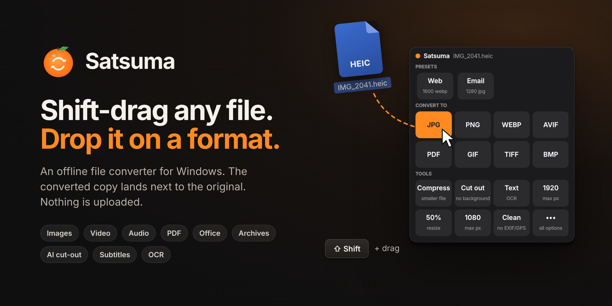
</p>

<p align="center">
  <a href="https://github.com/kalharakeh/satsuma/releases/latest"></a>
  <a href="https://github.com/kalharakeh/satsuma/actions/workflows/build.yml"></a>
  
  
  <a href="LICENSE"></a>
</p>

<p align="center">
  <b><a href="https://github.com/kalharakeh/satsuma/releases/latest/download/Satsuma-Setup.exe">⬇ Download Satsuma for Windows</a></b>
</p>

---

**Satsuma** is a file converter that lives where your files already are. Hold **Shift** while dragging any file in Explorer or on the desktop, and a panel of formats appears under your cursor. Drop the file on one and the converted copy is saved **next to the original**.

It works for **text** too: select some text in any app, Shift-drag it, and a copy lands wherever you let go.

You don't open an app, upload anything or wait in a queue. Everything runs on your own PC, and your original file is never changed.

> Inspired by Tangerine for Mac. Satsuma is an independent, open-source take on the idea for Windows.

<table>
<tr>
<td width="33%">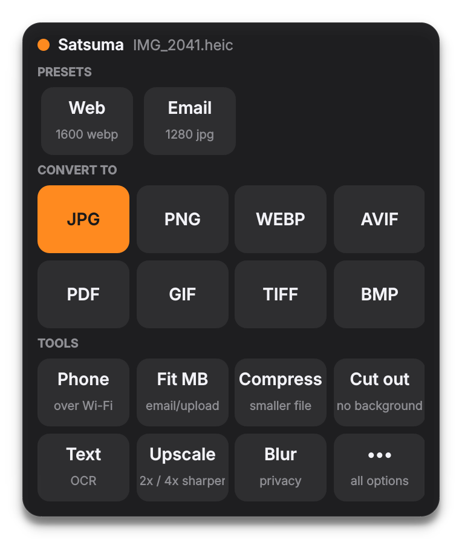</td>
<td width="33%">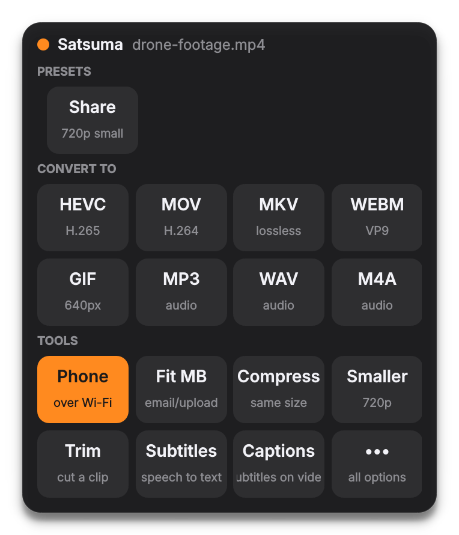</td>
<td width="33%">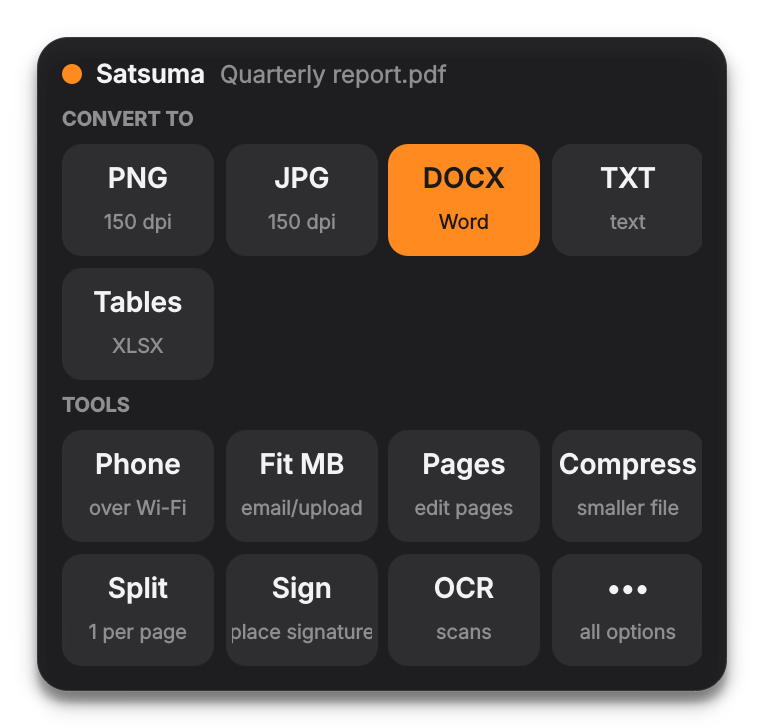</td>
</tr>
</table>

## What it does

| | Convert to | Tools |
|---|---|---|
| **Images** (JPG, PNG, HEIC, WEBP, AVIF, GIF, TIFF, BMP, ICO) | any of them, PDF, GIF→MP4 | **fit under X MB** · compress · **remove background** · **AI upscale 2×/4×** · **blur faces & areas** · extract text (OCR) · resize · strip EXIF/GPS · rotate · black & white · combine into one PDF |
| **Video** (MP4, MOV, MKV, AVI, WEBM, …) | MP4, HEVC, MOV, MKV, WEBM, GIF, MP3/WAV/M4A | **fit under X MB** · compress · trim · **join clips** · **speed up / slow down** · **GIF from a range** · subtitles from speech · **burn in captions** · **remove noise** · **save frames** · 1080p/720p · mute · rotate · thumbnail |
| **Audio** (MP3, WAV, FLAC, M4A, OGG, OPUS, …) | MP3, WAV, FLAC, M4A, OGG, OPUS, AIFF | **fit under X MB** · trim · transcribe · **remove noise** · **change speed** · normalize · compress |
| **PDF** | PNG, JPG, Word, **Excel (tables)**, TXT | **fit under X MB** · compress · merge · split · **reorder / delete / rotate pages** · **sign** · **watermark** · OCR scans · add/remove password |
| **Office** (DOCX, PPTX, XLSX, ODT, RTF) | PDF *(needs Office or LibreOffice)*, CSV | |
| **Data** | CSV ↔ XLSX / JSON | |
| **Photos & folders** | ZIP, 7Z | **sort into folders by date taken** · **find duplicates** · batch rename · extract archives |
| **Anything** | | **send to your phone** (QR code over Wi-Fi) |

## Highlights

### Shift-drag text

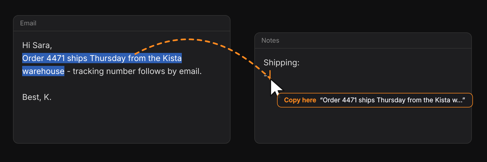

Select text in any app, hold **Shift** and drag. Let go anywhere to paste a copy there. You can also drop it on the small panel that appears:

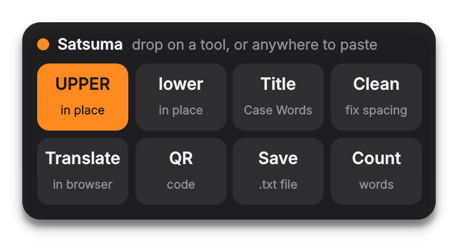

- **UPPER / lower / Title:** changes the selected text in place
- **Clean:** fixes text copied from PDFs by joining broken lines, removing double spaces and re-joining hyphenated words
- **Translate:** opens it in your browser's translator
- **QR:** turns the text (a link, Wi-Fi details, a note) into a QR code
- **Save** as a .txt file, or **Count** words and characters

Your clipboard is put back afterwards, and a plain Shift-click still works as usual.
<br clear="right">

### Fit under X MB

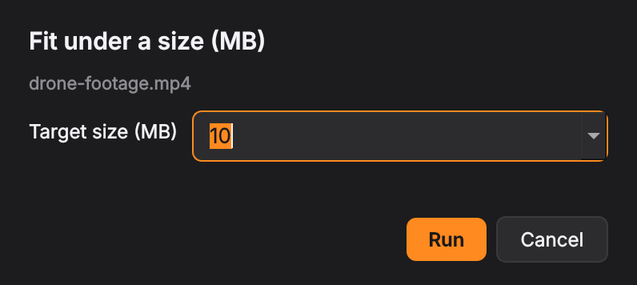

Email limit 10 MB? Discord 25 MB? A form that wants "max 2 MB"? Drop any **image, video, audio file or PDF** on *Fit MB* and pick the size. Satsuma finds the best quality that fits: two-pass encoding for video, and quality plus resolution search for images and PDFs.
<br clear="right">

### Send to phone

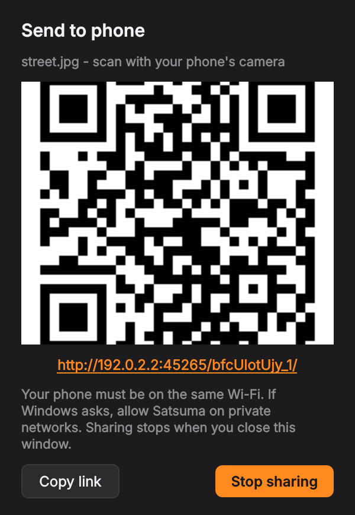

Drop anything on *Phone* and scan the QR code. The file downloads straight from your PC over your own Wi-Fi, with no cloud, account or cable. Folders and multiple files arrive as one zip, and sharing stops when you close the window.
<br clear="right">

### Privacy blur, PDF pages, signing

<table>
<tr>
<td width="40%">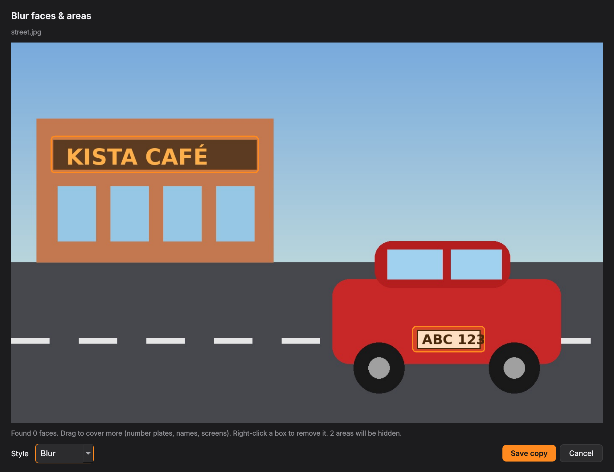</td>
<td width="33%">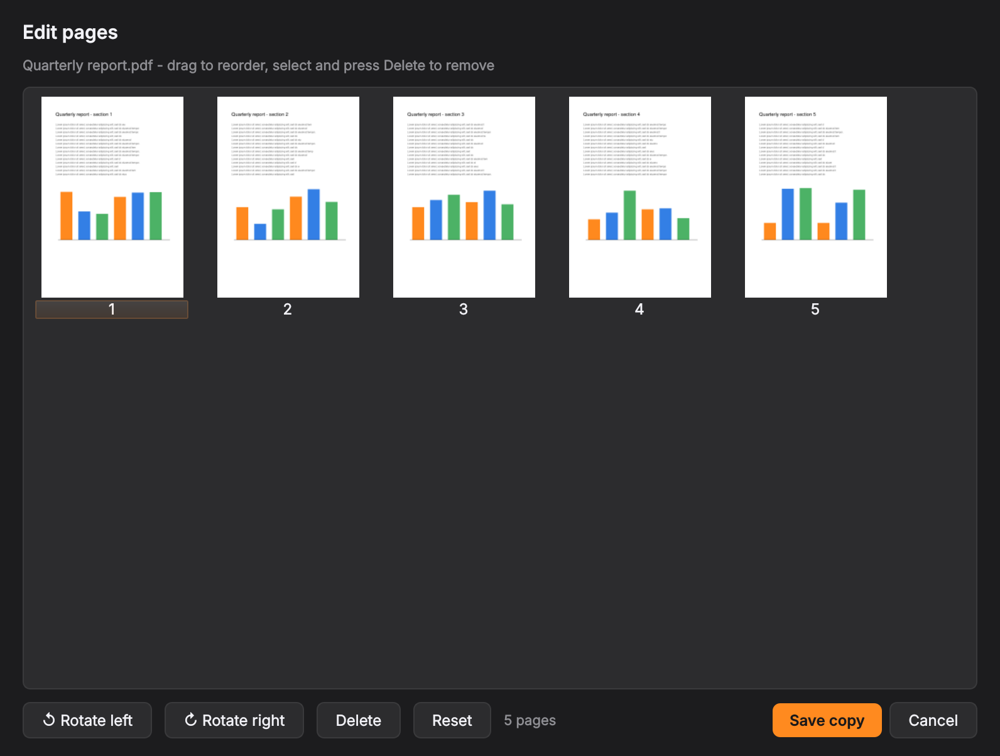</td>
<td width="27%">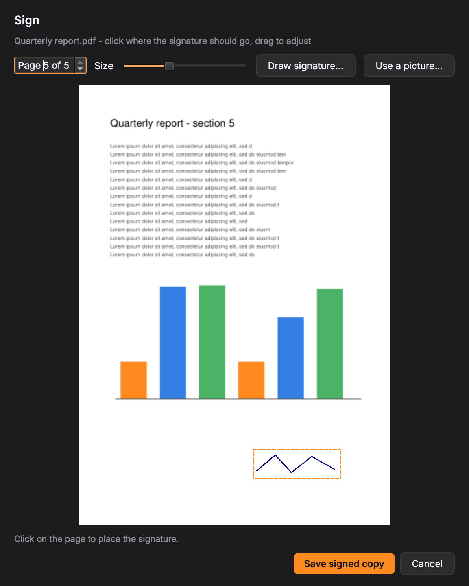</td>
</tr>
</table>

- **Blur:** faces are found automatically. Drag boxes over number plates, names or screens, and choose blur, pixelate or a black box. EXIF/GPS data is removed too.
- **Pages:** reorder pages by dragging, rotate them, or delete them.
- **Sign:** draw your signature once (or use a photo of it). Click where it goes, and Satsuma removes the paper background for you.

### Local AI

- **Remove background** (U²-Net), **upscale 2×/4×** (Real-ESRGAN), and **subtitles / transcripts** from speech (Whisper, ~100 languages). Everything runs on your CPU, and your files never leave the PC.
- The installer stays small. The AI libraries (~80 MB) download the first time you use an AI tool, or ahead of time from *Settings → AI tools*.

### Make it yours

- **Presets:** your own one-click tiles, like *"WEBP, max 1600 px, 80%"* or *"720p for WhatsApp"*. Create them in *Settings → Presets*.
- **Watch folders:** every new file in a folder is converted automatically, e.g. screenshots become WEBP.
- **Undo:** sends the last result to the Recycle Bin, or puts moved and renamed files back.
- **Updates:** Satsuma checks GitHub once a day, and a click updates it.

## Install

1. Download **[Satsuma-Setup.exe](https://github.com/kalharakeh/satsuma/releases/latest/download/Satsuma-Setup.exe)** and run it. No admin rights are needed.
2. Look for the orange icon in the tray. That's it.

> **Windows SmartScreen** may say it "protected your PC", because the installer isn't code-signed yet. Click **More info → Run anyway**. The installer is built from this repo's source by [GitHub Actions](https://github.com/kalharakeh/satsuma/actions), and you can check every build log.

Prefer no installer? Download `Satsuma-portable.zip` from [Releases](https://github.com/kalharakeh/satsuma/releases/latest), unzip it, and run `Satsuma.exe --install` once.

<details>
<summary><b>Run from source</b> (Python 3.10–3.13)</summary>

Double-click `install.bat`. It installs Python and FFmpeg with winget if they're missing, sets up a private environment in `%LOCALAPPDATA%\Programs\Satsuma`, and registers everything. Or do it manually:

```powershell
py -3.12 -m venv .venv
.venv\Scripts\pip install -r requirements.txt -r requirements-ai.txt
.venv\Scripts\pythonw app.py --install
```
</details>

## Use

| How | What happens |
|---|---|
| **Shift + drag** one or more files | The panel appears at the cursor. Drop on a tile, or on **•••** for every option. |
| **Shift + drag** selected text | Let go anywhere to paste a copy, or drop on a text tool. |
| **Right-click → Convert with Satsuma** | Same panel, click a tile. *(On Windows 11 it's under "Show more options".)* |
| **Send To → Satsuma** | Works with many selected files at once. |
| **Tray icon** | Convert files, Undo, Settings, updates. |

Output names never overwrite anything: `photo.jpg`, `photo-10MB.jpg`, `photo (1).jpg`.

## Privacy

Satsuma has no account, no telemetry and no cloud. Files are processed on your own machine. The only network requests are:

- the daily update check (GitHub)
- one-time downloads of the AI pack and models (GitHub, Hugging Face), only when you first use an AI tool
- *Translate*, which opens your browser's translator with the text you chose

## FAQ

**Does Shift-drag move my file?** No. In Explorer, Shift-drag normally means *move*, but Satsuma always accepts the drop as a *copy*.

**The panel doesn't appear when I drag from some app.** By default, file drags only count from Explorer, the desktop and Open/Save dialogs. You can change this in *Settings*. Windows also blocks drag-and-drop and text-drag for apps running as administrator.

**Send to phone doesn't load.** Both devices need to be on the same network. The first time, Windows asks whether to allow Satsuma on private networks; say yes.

**Where are the logs?** In `%APPDATA%\Satsuma\satsuma.log` (tray → *Open log*).

**How do I uninstall?** Use *Settings → Apps → Satsuma → Uninstall*. The AI pack and models live in `%LOCALAPPDATA%\Satsuma`; delete that folder too to free the space.

## Roadmap

- [ ] Entry in the Windows 11 top-level right-click menu (needs a signed shell extension)
- [ ] Code-signed installer
- [ ] Offline translation
- [ ] Audio stem separation (vocals / music)
- [ ] UI translations

Ideas and bug reports are welcome in **[Issues](https://github.com/kalharakeh/satsuma/issues)**.

## How it's built

`app.py` is the tray app, drop panel, text panel and progress cards (PySide6). `hook.py` and `textdrag.py` handle Shift-drag detection with a low-level mouse hook. Each conversion runs in its own child process (`engine.py`, `features.py`, `tools2.py`), so a crash or a huge video never freezes the UI. `tests/` runs ~50 real conversions plus the text-drag logic, and CI runs them on Windows against both the source and the built `.exe` before every release.

## License

[AGPL-3.0](LICENSE), because Satsuma builds on [PyMuPDF](https://github.com/pymupdf/PyMuPDF) (AGPL). Bundled and downloaded components keep their own licenses:

- [FFmpeg](https://ffmpeg.org) (GPL), shipped as a separate program in `bin`
- [Real-ESRGAN](https://github.com/xinntao/Real-ESRGAN) (BSD-3)
- [YuNet](https://github.com/opencv/opencv_zoo) (MIT)
- [U²-Net](https://github.com/xuebinqin/U-2-Net) (Apache-2.0)
- [Whisper](https://github.com/openai/whisper) (MIT)

Made in Stockholm by [Kassem Alharakeh](https://github.com/kalharakeh).
