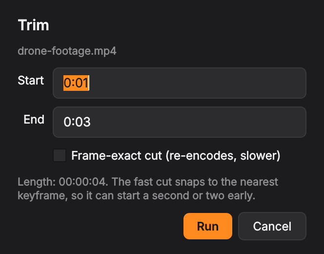
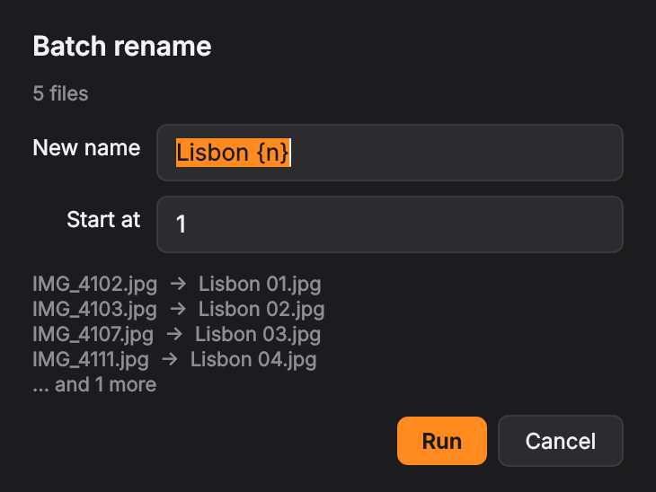
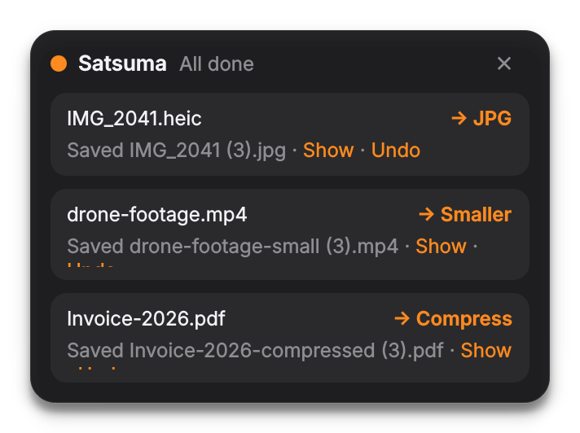
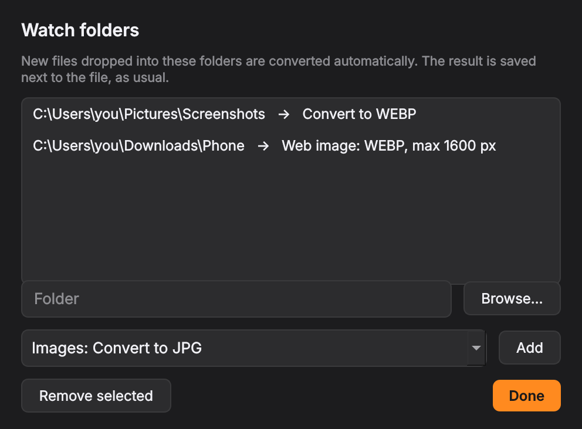

<p align="center">
  
</p>

<p align="center">
  <a href="https://github.com/kalharakeh/satsuma/releases/latest"></a>
  <a href="https://github.com/kalharakeh/satsuma/actions/workflows/build.yml"></a>
  
  
  <a href="LICENSE"></a>
</p>

<p align="center">
  <b><a href="https://github.com/kalharakeh/satsuma/releases/latest/download/Satsuma-Setup.exe">⬇ Download Satsuma for Windows</a></b>
</p>

---

**Satsuma** is a file converter that lives where your files already are. Hold **Shift** while dragging any file in Explorer or on the desktop: a panel of formats appears under your cursor. Drop the file on one and the converted copy is saved **next to the original**.

It works for **text** too: select some text in any app, Shift-drag it, and a copy lands wherever you let go.

You don't open an app, upload anything or wait in a queue. Every conversion runs on your own PC, and your original file is never changed.

> Inspired by Tangerine for Mac. Satsuma is an independent, open-source take on the idea for Windows.

## What it does

<table>
<tr>
<td width="50%"></td>
<td width="50%"></td>
</tr>
</table>

| | Convert to | Tools |
|---|---|---|
| **Images** (JPG, PNG, HEIC, WEBP, AVIF, GIF, TIFF, BMP, ICO) | any of them, PDF, GIF→MP4 | compress · **remove background** · **extract text (OCR)** · resize · strip EXIF/GPS · rotate · black & white · combine into one PDF |
| **Video** (MP4, MOV, MKV, AVI, WEBM, …) | MP4 (H.264), HEVC, MOV, MKV, WEBM, GIF, MP3/WAV/M4A | compress · **trim** · **subtitles from speech** · 1080p/720p · mute · rotate · thumbnail · strip metadata |
| **Audio** (MP3, WAV, FLAC, M4A, OGG, OPUS, …) | MP3, WAV, FLAC, M4A, OGG, OPUS, AIFF | **trim** · **transcribe** · normalize loudness · compress · strip tags |
| **PDF** | PNG, JPG, Word (DOCX), TXT | compress · merge · split · **OCR scanned pages** · **add/remove password** · rotate · strip metadata |
| **Office** (DOCX, PPTX, XLSX, ODT, RTF) | PDF *(needs Office or LibreOffice)*, CSV | |
| **Data** | CSV ↔ XLSX / JSON | |
| **Anything** | ZIP, 7Z | extract (ZIP, 7Z, RAR, TAR, GZ) · **batch rename** |

### Shift-drag text


Select text in any app, hold **Shift** and drag it, then let go somewhere else: in another window, another app, or later in the same document. A copy is typed in where you released. The original text isn't touched, and your clipboard is put back afterwards. Right-click while dragging to cancel.

A plain Shift-click still works as usual, and if nothing is selected, a Shift-drag behaves normally. You can switch this off in the tray menu (*Shift-drag selected text*).

### The extras

- **🪄 Remove background:** cuts the subject out of a photo and saves a transparent PNG. It uses a local U²-Net model.
- **💬 Subtitles from speech:** drop a video and get an `.srt` file plus a plain transcript. It uses Whisper, works in ~100 languages, and runs on your CPU.
- **🔎 Text from images and scans:** uses Windows' built-in OCR (the languages you have installed), with an offline fallback.
- **✂️ Trim:** cut a clip from a video or audio file by start and end time. The fast cut doesn't re-encode, or you can choose a frame-exact cut.
- **🔒 PDF passwords:** add AES-256 protection or remove it.
- **🏷️ Batch rename:** use patterns like `Lisbon {n}`, `{taken} {name}` or `{date}`, with a live preview before anything changes.
- **⭐ Presets:** your own one-click tiles, e.g. *"WEBP, max 1600 px, 80%"* or *"720p for WhatsApp"*.
- **📂 Watch folders:** every new file in a folder gets converted automatically, e.g. screenshots become WEBP.
- **↩️ Undo:** sends the last result to the Recycle Bin, or puts renamed files back.

The AI features download their model once on first use (cut-out ~170 MB, speech ~460 MB). After that they work without internet.

<table>
<tr>
<td width="33%"></td>
<td width="33%"></td>
<td width="33%"></td>
</tr>
</table>

## Install

1. Download **[Satsuma-Setup.exe](https://github.com/kalharakeh/satsuma/releases/latest/download/Satsuma-Setup.exe)** and run it. No admin rights are needed.
2. Look for the orange icon in the tray. That's it.

> **Windows SmartScreen** may say it "protected your PC", because the installer isn't code-signed yet. Click **More info → Run anyway**. The installer is built from this repo's source by [GitHub Actions](https://github.com/kalharakeh/satsuma/actions), and you can check every build log.

Prefer no installer? Download `Satsuma-portable.zip` from [Releases](https://github.com/kalharakeh/satsuma/releases/latest), unzip it, and run `Satsuma.exe --install` once.

<details>
<summary><b>Run from source</b> (Python 3.10–3.13)</summary>

Double-click `install.bat`. It installs Python and FFmpeg with winget if they're missing, creates a private virtual environment in `%LOCALAPPDATA%\Programs\Satsuma`, and registers everything. Or do it manually:

```powershell
py -3.12 -m venv .venv
.venv\Scripts\pip install -r requirements.txt
.venv\Scripts\pythonw app.py --install
```
</details>

## Use

| How | What happens |
|---|---|
| **Shift + drag** one or more files | The panel appears at the cursor. Drop on a tile, or on **•••** for every option. |
| **Shift + drag** selected text | A copy is pasted where you release the mouse. |
| **Right-click → Convert with Satsuma** | Same panel, click a tile. *(On Windows 11 it's under "Show more options".)* |
| **Send To → Satsuma** | Works with many selected files at once. |
| **Tray icon** | Convert files, Undo, Edit presets, Watch folders, settings. |

Output names never overwrite anything: `photo.jpg`, `photo-compressed.jpg`, `photo (1).jpg`.

<details>
<summary><b>Presets</b>: make your own tiles</summary>

Tray → **Edit presets…** opens `%APPDATA%\Satsuma\presets.json`. Save the file and the tiles update immediately.

```json
{
  "presets": [
    { "name": "Web image", "tile": "Web", "hint": "1600 webp", "for": "image",
      "format": "webp", "quality": 80, "max_px": 1600, "strip": true, "tag": "web" },
    { "name": "WhatsApp video", "tile": "Share", "hint": "720p", "for": "video", "ext": ".mp4",
      "ffmpeg": ["-c:v", "libx264", "-crf", "28", "-vf", "scale=-2:720", "-c:a", "aac", "-b:a", "96k"] }
  ]
}
```

- **Images:** `format` (jpg, png, webp, avif, heic), `quality`, `max_px`, `strip`.
- **Video and audio:** `ext` plus any FFmpeg output arguments in `ffmpeg`.
</details>

<details>
<summary><b>Watch folders</b></summary>

Tray → **Watch folders…** lets you pick a folder and an action. New files get converted once they've finished copying. Files already in the folder, and Satsuma's own results, are left alone.


</details>

## Privacy

Satsuma has no account, no telemetry and no cloud. Files are processed by FFmpeg, Pillow, PyMuPDF, ONNX Runtime and Whisper on your own machine. The only network requests are the one-time model downloads for background removal (from GitHub) and speech-to-text (from Hugging Face), and only when you first use those tools.

## FAQ

**Does Shift-drag move my file?** No. In Explorer Shift-drag normally means *move*, but Satsuma always accepts the drop as a *copy*, so the original stays where it was.

**The panel doesn't appear when I drag from some app.** By default Satsuma only reacts to drags that start in Explorer, on the desktop or in Open/Save dialogs, so Shift-selecting text elsewhere doesn't pop it up. You can turn that off in the tray menu. Windows also blocks drag-and-drop from apps running as administrator into normal apps; use the right-click entry there.

**Text drag doesn't work in one app.** Windows doesn't let normal apps send input to apps running as administrator, so Satsuma leaves those windows alone. Terminals, the taskbar and the Start menu are skipped on purpose.

**Where are the logs?** In `%APPDATA%\Satsuma\satsuma.log` (tray → *Open log*).

**How do I uninstall?** Use *Settings → Apps → Satsuma → Uninstall*. Models live in `%LOCALAPPDATA%\Satsuma`. Delete that folder too if you want the disk space back.

## Roadmap

- [ ] Entry in the Windows 11 top-level right-click menu (needs a signed shell extension)
- [ ] Code-signed installer
- [ ] Image upscaling (local model)
- [ ] Audio stem separation (vocals / music)
- [ ] Translations of the UI

Ideas and bug reports are welcome in **[Issues](https://github.com/kalharakeh/satsuma/issues)**.

## How it's built

`app.py` is the tray app, drop panel and progress cards (PySide6). `hook.py` handles Shift-drag detection (a low-level mouse hook). Each conversion runs in its own child process (`engine.py`, `features.py`, `presets.py`), so a crash or a huge video never freezes the UI. `tests/smoke_test.py` runs real conversions, and CI runs it on Windows against both the source and the built `.exe` before every release.

## License

[AGPL-3.0](LICENSE), because Satsuma builds on [PyMuPDF](https://github.com/pymupdf/PyMuPDF) (AGPL). The installer bundles [FFmpeg](https://ffmpeg.org) (GPL) as a separate program. Its license and source link are in the `bin` folder.

Made in Stockholm by [Kassem Alharakeh](https://github.com/kalharakeh).
